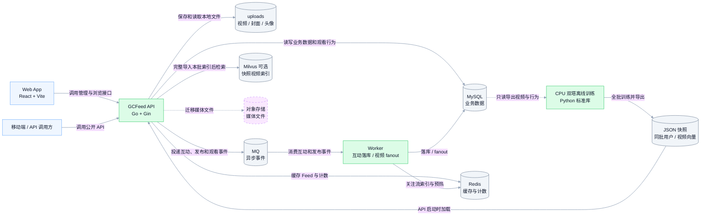
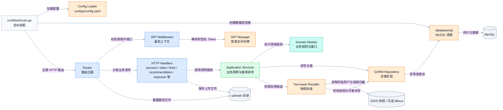
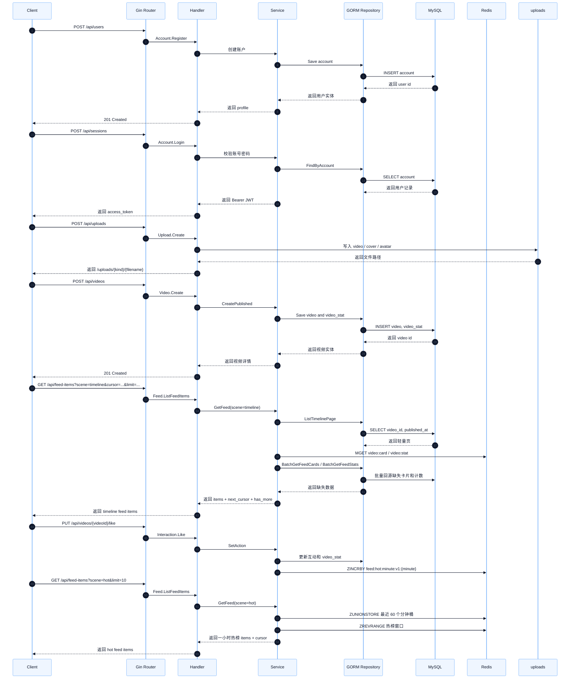
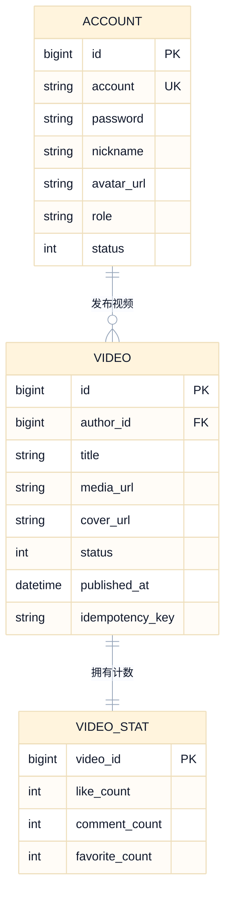
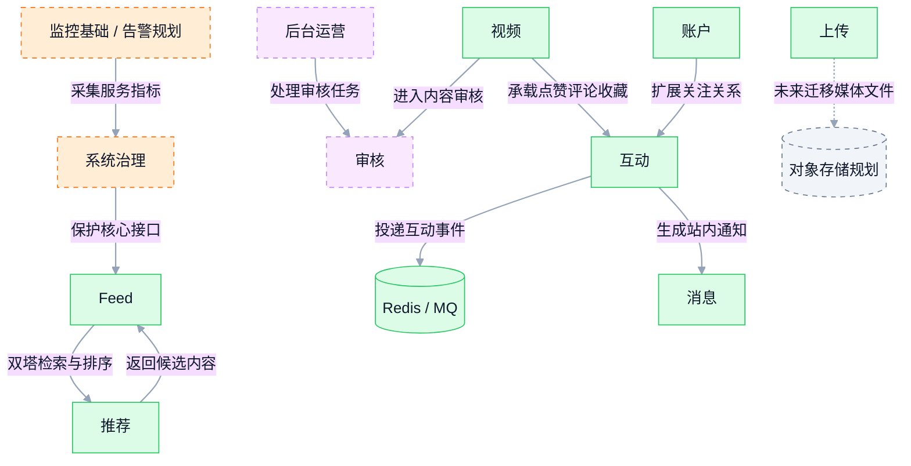

# 视频 Feed 系统架构

GCFeed 由 Go API、异步 Worker 和 React Web 组成。推荐模型在 CPU 上离线训练，API 加载同批用户和视频向量，在本机或 Milvus 中检索。图中虚线表示离线数据传递或规划中的能力。[训练说明](../tools/twotower/README.md) · [推荐模块](modules/recommendation.md)

## 1. 系统上下文

这张图展示客户端、API、Worker、离线训练与存储的边界。对象存储迁移仍属规划。

## 2. API 内部分层

这张图展示 Go API 单体内部的主要代码层次和依赖方向。

## 3. 核心请求链路

这张图展示从注册、登录、上传、发布到最新流和热门流的主要链路。推荐流另见下方说明。

### 推荐流与离线更新

`RecommendStrategy.List` 需要登录，调用推荐服务和快照召回器；召回器使用快照中的个人向量或默认用户向量检索，再批量校验视频已发布且作者正常。推荐服务按相似度排序、去重和剔除近期曝光，分页后做同作者打散，Feed 最后复用卡片与计数的批量组装。

Web 将有效观看和完播写入 `video_view_events`。新增行为、新用户历史和新视频在下次 CPU 训练、导出完整快照并重启 API 后生效；当前没有消费观看消息来实时修改双塔向量的 Worker。可选 Milvus 使用快照内容摘要隔离集合，完整导入该批视频向量后才接受查询。

快照缺失时，推荐首屏走最新流，续页保留 `latest.` 游标和最新流排序。快照损坏、Milvus 未就绪或索引故障返回 503；有效模型没有候选时返回空列表。模型推荐游标绑定快照版本，升级后需刷新首屏。详细边界见[Feed 模块](modules/feed.md#6-recommend-读取与分页)。

## 4. 数据模型

这张图只展示内容查询依赖的三张核心表。实际自动迁移还覆盖会话、关系、互动、消息、播放、观看行为和曝光等表；完整列表以 `internal/infra/persistence/migration/migration.go` 为准。

## 5. 演进能力地图

这张图展示已落地模块和规划模块的连接方式。审核、后台运营、完整治理仍属规划；Prometheus/Grafana 基础采集与看板已经接入，完整告警管理仍待补齐。

## 6. 说明

- 当前代码以 Go API 单体承载用户端业务和推荐检索，内部按接口层、应用层、领域层、基础设施层组织；互动落库和视频 fanout 由独立 Worker 进程消费。
- 对外接口统一挂载在 `/api/*`，静态文件通过 `/uploads/*` 访问，健康检查使用 `/health`。
- MySQL 保存业务事实和观看行为，Redis 保存 Feed 缓存、短期行为状态和热榜；双塔服务读取本批训练快照，旧 `video_embedding` 表不是当前双塔向量来源。
- Feed 通过 `scene` 分发 `timeline`、`hot`、`following`、`recommend` 四个策略，分别对应最新、热门、关注和双塔推荐。关注、热门频道保持独立。
- 审核、后台运营和治理能力仍是演进边界；服务拆分方案见 [evolution.md](evolution.md)，不代表当前已经部署微服务。
