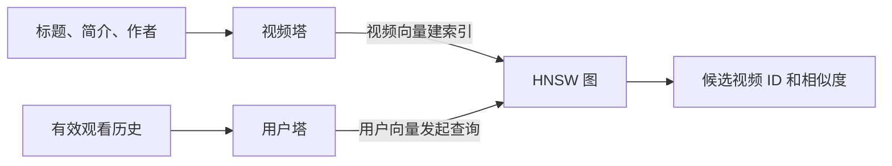

# 从一次观看到百万视频召回

在 GCFeed 里，一次有效观看先成为训练样本。离线双塔模型用这些样本学习如何把用户和视频表示成向量。用户打开推荐页时，Go API 拿用户向量去视频索引里找候选。理解这条链路，可以从三个问题入手：**向量怎么学出来？最近的几个视频怎么找？数据变化后要重算什么？**

## 1. 用户向量和视频向量从哪里来

以仓库的吉他样例为例。账号 3 先完播了《吉他教程1》，第二天又完播了《吉他教程2》。训练第二次观看时，用户塔只能看见第一天的历史。如果提前把第二条视频也加进去，就把要预测的答案泄露给了模型。

| 送进哪个塔 | 这条样本用什么 | 算出什么 |
| --- | --- | --- |
| 用户塔 | 历史视频《吉他教程1》的内容特征。有多条有效观看时，先累加各条视频的内容特征，再归一化 | 128 维用户向量 `u` |
| 视频塔 | 正例《吉他教程2》的作者 ID、标题、简介 | 128 维视频向量 `v+` |
| 同一个视频塔 | 采样视频《篮球教程4》的作者 ID、标题、简介 | 128 维视频向量 `v−` |

视频标题和简介会拆成词和字符片段，和作者特征一起映射到固定的特征桶。两个塔各有一套可训练的权重，各自做加权组合、`tanh` 变换和长度归一化。一个用户一段历史、一个视频一份元数据，因此可以分别编码；它们是否匹配，则要把两端的输出放在一起看。[特征、历史与两个塔的实现](../tools/twotower/train.py)

## 2. 一条观看怎么改变两个塔

GCFeed 默认把完播或至少 3 秒的有效播放当作正反馈。同一用户对同一视频只取第一次合格事件。负例从当时已发布、该用户此前没有正反馈的其他视频中抽取。抽到《篮球教程4》只说明它用来做对照，用户可能根本没看见它。

用户和视频向量的长度都是 1，所以点积就是余弦相似度。对于同一用户，训练器比较两个分数：`u · v+` 和 `u · v−`。BPR 损失鼓励前者领先后者；分差越小，这条样本给出的纠正信号越强。训练器把这个信号传回用户塔和视频塔，调整两边的权重。[BPR 原论文](https://arxiv.org/abs/1205.2618)

下面是用上面这条合成样本实际训练一步的结果。模型从随机初始化开始，初始化和采样种子均为 42，学习率为 0.025，温度为 0.2。更新前后输入完全相同。

| 同一个用户与同一对视频 | 更新前 | 更新一步后 |
| --- | ---: | ---: |
| 与《吉他教程2》的相似度 | 0.203 | 0.361 |
| 与《篮球教程4》的相似度 | −0.007 | −0.214 |
| 正例领先的分差 | 0.210 | 0.575 |

**为什么视频标题没改，向量也会变？** 变的是视频塔把特征映射为向量的权重。所有视频共享这套权重，所以连没有出现在本次样本里的《吉他和弦入门》，也可能因共享“吉他”等特征，在下次编码时得到不同的向量。新发布的视频即使还没有自己的观看记录，也能用训练好的视频塔编码。

同一份快照里，某个视频的向量固定，但每个用户拿来和它比较的向量可以不同。“这个视频得 0.361 分”只有在指定用户和快照后才有意义。当天新增的观看先记入数据库，等下次训练、导出并加载快照，才会更新当前实现使用的个人向量。[快照格式与更新方式](../tools/twotower/README.md#导出与接入契约)

## 3. 几百万个视频，打开推荐页时算哪些分

GCFeed 提前保存用户和视频向量；配置 Milvus 时，还会为视频向量准备可供所有用户共用的 HNSW 索引。用户请求到来，Go 用个人向量查询，没有个人向量时使用训练得到的默认向量。相似度在查询时计算。没有模型文件时，已登录用户的推荐首屏展示最新流，这是另一种启动状态。[在线召回实现](../apps/api/internal/infra/twotower/model.go)



| 检索方式 | 请求到来后做什么 | 取舍 |
| --- | --- | --- |
| 本机精确检索 | 将用户向量和目录中每条视频的向量算一次点积，再排序 | 小目录容易验证，也能提供精确 Top K 作为参照 |
| Milvus HNSW | 从分层图的入口开始，沿相邻节点寻找更接近用户向量的区域，再在底层扩大局部搜索 | 通常只比较部分视频，结果是近似 Top K，可能漏掉全库里真正的近邻 |

这里的 **K** 是想取回的候选数量。取回 20 条通常要访问超过 20 个节点。召回结果也只是候选，GCFeed 还会校验视频和作者状态，去重、剔除近 7 天曝光，分页后错开同作者内容。即使快照和匹配分都没变，一条刚刚曝光的视频也可能从下一次请求的结果里消失。[推荐服务](../apps/api/internal/application/recommendation/service.go)

## 4. HNSW 怎么知道该给哪些视频连边

建图的第一步只需要一个视频作为入口。此后每插入一个新视频 X，都可以**拿 X 的向量查询已经建好的图**，利用现有连边找到一批候选邻居。

1. **选层。** 每条视频都进入底层，再随机决定它能到达的最高层。高层只有少量节点，能用较少的跳转靠近目标区域。
2. **找邻居。** 从最高层的入口出发，比较 X 与沿途节点的距离，向更接近 X 的节点移动。下降到 X 要加入的层时，保留多个候选，探索它们的邻居。
3. **连边。** 从候选里选少量节点与 X 连接，并更新相邻节点的连接表。选邻居的启发式会兼顾通往不同方向的路径，连接过多时再修剪。下一条视频插入时，已经可以沿着经过 X 的路径搜索。[HNSW 原论文，算法 1–4](https://arxiv.org/pdf/1603.09320#page=4)

如果有 300 万条视频，两两比较大约有 4.5 万亿对。HNSW 通过在已有图上找局部候选，省掉了全量配对。GCFeed 用 `COSINE` 衡量相似度。`M=16` 控制连边规模，`efConstruction=200` 控制建图时的候选集合宽度。200 不能直接换算为每次插入的距离计算次数。服务查询时使用另一项参数 `ef`，调大它通常会搜索更多候选，可以用延迟和近邻召回率来衡量是否值得。[GCFeed 的 Milvus 配置](../apps/api/internal/infra/vector/milvus.go) · [Milvus 2.4 索引参数](https://milvus.io/docs/v2.4.x/index.md)

## 5. 数据变了，该更新向量还是重建索引

可以先问：**视频库里的点和它们所在的向量空间变了吗？** 用户向量是一次查询的输入；视频向量才是建图的数据。这个区别决定了理论上能复用什么。GCFeed 当前为了保证版本一致，按完整快照发布，处理比理论最小范围更粗。

| 发生的变化 | 可以怎样处理 | GCFeed 当前的行为 |
| --- | --- | --- |
| 同一版模型下，用户新增观看历史 | 用原用户塔重新编码这位用户，用新用户向量查原视频索引 | 先记行为，个人向量随下一份训练快照更新 |
| 视频塔不变，新视频发布或少量视频改标题 | 用原视频塔编码新增或变动的视频 ID，将这些向量写入原版本索引 | 新内容和元数据变更随下次离线导出进入推荐 |
| 重新训练两座塔，全库视频重新编码 | 为新版视频向量准备配套索引，新用户向量查询新版索引 | 从新快照创建独立的 Milvus 集合，按每批最多 500 条导入全部视频 |
| 原封不动地重启 API | 相同视频数据可以复用原索引 | 集合名保持相同，当前每个 API 进程仍会全量执行一次 upsert |

快照保存的是导出的向量，当前 Go 服务里没有能单独重新编码用户或新视频的模型参数。Milvus 集合名取自**整份快照文件的 SHA-256**，所以即使只有用户向量或版本字段改变，也会得到新的集合名。按 300 万条、每批 500 条计算，一次完整导入约需 6,000 批写入。这个数字描述写入批数，实际建图时间和内存要用对应规模的数据测量。[快照读取与导入](../apps/api/internal/infra/twotower/model.go) · [集合与 HNSW 索引](../apps/api/internal/infra/vector/milvus.go)

**百万规模时如何切换。** 可以让旧实例继续用 V1 用户向量查询 V1 索引，另外准备 V2。用固定查询对比 V2 的 HNSW 结果与同版本精确 Top K 的重合率，并检查目录覆盖、延迟和少量真实 Feed 请求。通过后，再把新首屏请求切到 V2，保留配套的 V1 快照和索引用于回滚。这里测的是**索引能否找回模型的近邻**；衡量**模型能否推荐出用户随后观看的内容**，需要按时间留出的行为数据。两种验证回答不同的问题。

GCFeed 当前在进程启动时固定一份快照，替换文件后要重启 API。启用 Milvus 时，`two-tower index ready` 表示该实例完成集合准备且所有批次 upsert 成功，随后开放检索；仍需用查询验证覆盖和质量。单实例在准备期间会对新的推荐首屏返回 503，平滑切流需要额外的部署安排。换版后模型分页应回到首屏刷新，带 `latest.` 的续页则继续按时间线浏览。[Feed 分页与异常处理](modules/recommendation.md)

## 6. 用两个账号验证同一条视频的分数

从仓库根目录运行下面的命令。它用仓库的合成数据在 CPU 上训练 12 轮，把结果写入临时目录，无需启动数据库。接着，直接用同一份快照给两位用户和同两条视频打分，观察他们各自把哪条排在前面。

```bash
demo_dir=$(mktemp -d)
python3 tools/twotower/train.py --demo --epochs 12 --k 3 --output "$demo_dir/model.json"
python3 - "$demo_dir/model.json" <<'PY'
import json
import sys

with open(sys.argv[1], encoding="utf-8") as f:
    model = json.load(f)

for uid in ("1", "3"):
    user = model["users"][uid]
    for vid, title in [("5", "篮球教程5"), ("11", "吉他教程5")]:
        video = model["videos"][vid]
        score = sum(a * b for a, b in zip(user, video))
        print(f"用户 {uid}  {title}  {score:.3f}")
PY
```

保留默认种子时，账号 1 的篮球、吉他分数分别约为 `0.312` 和 `−0.503`，账号 3 则为 `−0.615` 和 `−0.036`。账号 3 的两个分数都小于零，吉他仍排在篮球前面。推荐看的是同一用户对不同候选的相对匹配程度。

训练命令另外输出时间留出评估。这份合成样例里，有训练历史的用户命中 12/12 次，冷用户命中 0/1 次，整体 Recall@3 是 12/13。分母是后续观看事件数。自己的项目还没有观看数据时，可以先用最新流收集有效播放和完播，再用本实例的视频 ID 导出、评估并生成部署快照。[真实数据导出、评估与上线](../tools/twotower/README.md#从-mysql-导出真实样本)
